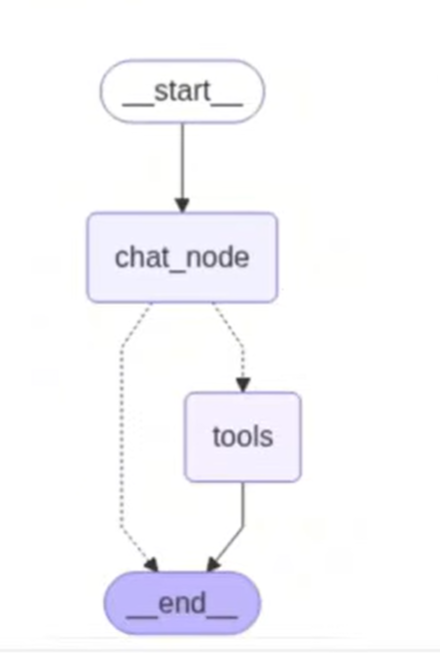

# Agentic-chatbot-GPT

**CGPT** est un chatbot agentique inspiré de ChatGPT, construit avec **LangGraph** et **LangChain**. L'agent s'appuie sur un LLM compatible OpenAI et peut appeler des outils externes : recherche web, calculatrice, cours de bourse, météo et date/heure en temps réel.

> 🚧 **Projet en cours de développement** : les outils de l'agent (`src/tools/tools.py`), l'état du graphe (`src/states/state.py`) et le prompt système (`src/agents/prompt.py`) sont implémentés. Le graphe de l'agent est conçu (voir [Architecture](#architecture-de-lagent)) et son implémentation est en cours. Le RAG, la base de données, l'API et l'interface sont à venir.

## Stack technique

| Composant | Rôle |
| --- | --- |
| [LangGraph](https://github.com/langchain-ai/langgraph) | Orchestration de l'agent sous forme de graphe d'états |
| `langgraph-checkpoint-sqlite` | Persistance de la mémoire de conversation (SQLite) |
| [LangChain](https://github.com/langchain-ai/langchain) (`langchain`, `langchain-core`, `langchain-community`, `langchain-openai`) | Abstractions LLM, outils et intégrations |
| [Tavily](https://tavily.com/) (`tavily-python`, `langchain-tavily`) | Recherche web |
| [Chroma](https://www.trychroma.com/) (`chromadb`, `langchain-chroma`) | Base vectorielle pour le RAG |
| `pypdf`, `docx2txt`, `langchain-text-splitters` | Chargement et découpage des documents (PDF, DOCX) |
| [FastAPI](https://fastapi.tiangolo.com/) + Uvicorn + Jinja2 | API et interface web |
| [Streamlit](https://streamlit.io/) | Interface de chat (alternative) |
| SQLAlchemy | Accès base de données |
| [LangSmith](https://smith.langchain.com/) | Traçage et observabilité (optionnel) |

## Outils de l'agent

Définis dans [src/tools/tools.py](src/tools/tools.py) avec le décorateur `@tool` de LangChain :

| Outil | Description | Service / clé requise |
| --- | --- | --- |
| `web_search` | Recherche d'informations récentes sur Internet (titre, URL, extrait) | Tavily — `TAVILY_API_KEY` |
| `calculator` | Évalue une expression mathématique simple (`2 + 2`, `math.sqrt(16)`…) | Aucune |
| `get_stock_price` | Dernier cours d'une action à partir de son symbole (`AAPL`, `TSLA`…) | Alpha Vantage — `ALPHA_VANTAGE` |
| `get_current_weather` | Météo actuelle d'une ville : conditions, température, humidité, pression, vent | OpenWeather — `OPEN_WEATHER_API_KEY` |
| `get_datetime_information` | Date et heure actuelles, jour de la semaine, veille et lendemain (fuseau par défaut : `Africa/Abidjan`) | Aucune |

Outils prévus par le prompt système, pas encore implémentés :

| Outil | Description |
| --- | --- |
| `search_uploaded_documents` | Recherche dans les documents importés par l'utilisateur (RAG) |
| `remember_this` | Mémorise une information importante sur l'utilisateur |
| `recall_memory` | Retrouve les préférences et les faits mémorisés |

## Prompt système

Le comportement de l'assistant est défini dans [src/agents/prompt.py](src/agents/prompt.py) (`SYSTEM_PROMPT`). L'assistant s'appelle **CGPT** et suit ces règles :

| Situation | Comportement attendu |
| --- | --- |
| Actualités, événements récents, prix actuels | Recherche web (Tavily), en précisant que la réponse s'appuie sur des résultats web |
| Question sur un document importé | `search_uploaded_documents` |
| « Souviens-toi de… » | `remember_this` |
| Question sur des préférences ou des faits enregistrés | `recall_memory` |
| Calcul mathématique | `calculator` |
| Autres questions | Réponse directe, claire et concise |

## Architecture de l'agent

L'agent est un graphe d'états LangGraph (`StateGraph`) :



| Nœud | Rôle |
| --- | --- |
| `__start__` | Point d'entrée : reçoit le message de l'utilisateur |
| `chat_node` | Appelle le LLM (`ChatOpenAI`, avec les outils liés). Le modèle répond directement ou demande l'appel d'un outil |
| `tools` | `ToolNode` qui exécute les outils demandés par le LLM (voir [Outils de l'agent](#outils-de-lagent)) |
| `__end__` | Fin de l'exécution du graphe |

**Flux :**

1. `__start__` → `chat_node` : le message entre dans le graphe.
2. `chat_node` → `tools` ou `__end__` (arêtes en pointillés) : le routage conditionnel `tools_condition` envoie vers `tools` si le LLM a demandé un outil, sinon vers `__end__`.
3. `tools` → `__end__` : une fois les outils exécutés, le graphe se termine.

**État du graphe :** défini dans [src/states/state.py](src/states/state.py) (`ChatState`), une liste de `messages` fusionnée par le reducer `add_messages`.

**Mémoire :** l'historique des conversations est enregistré dans SQLite avec `SqliteSaver` (`langgraph-checkpoint-sqlite`).

## Structure du projet

```text
Agentic-chatbot-GPT/
├── app.py                  # Point d'entrée de l'application (FastAPI)
├── requirements.txt        # Dépendances Python
├── src/
│   ├── agents/
│   │   ├── agent.py        # Graphe de l'agent LangGraph et configuration des modèles
│   │   └── prompt.py       # Prompt système de l'assistant (SYSTEM_PROMPT)
│   ├── data/               # Données locales (créé au démarrage de l'agent)
│   ├── db/
│   │   └── database.py     # Accès base de données (SQLAlchemy / SQLite)
│   ├── rag/
│   │   └── rag.py          # Ingestion de documents et recherche dans Chroma
│   ├── states/
│   │   └── state.py        # État du graphe (ChatState)
│   └── tools/
│       └── tools.py        # Outils mis à disposition de l'agent
├── templates/
│   └── index.html          # Interface de chat (template Jinja2)
├── imgs/
│   └── graph.png           # Schéma du graphe LangGraph
├── .env                    # Variables d'environnement (non versionné)
└── LICENSE
```

| Module | État |
| --- | --- |
| `src/tools/tools.py` | ✅ Implémenté |
| `src/states/state.py` | ✅ Implémenté |
| `src/agents/prompt.py` | ✅ Implémenté |
| `src/agents/agent.py` | 🚧 En cours (configuration des modèles) |
| `src/rag/rag.py` | 🚧 À implémenter |
| `src/db/database.py` | 🚧 À implémenter |
| `templates/index.html` | 🚧 À implémenter |
| `app.py` | 🚧 À implémenter |

## Installation

Prérequis : [Anaconda](https://www.anaconda.com/) ou [Miniconda](https://docs.conda.io/en/latest/miniconda.html).

```bash
git clone <url-du-depot>
cd Agentic-chatbot-GPT

# Créer l'environnement conda avec Python 3.12
conda create -n <nom_conda> python=3.12 -y

# Activer l'environnement
conda activate <nom_conda>

# Installer les dépendances
pip install -r requirements.txt
```

Pour désactiver l'environnement : `conda deactivate`.

## Configuration

Créez un fichier `.env` à la racine du projet avec les variables suivantes :

```env
# LLM principal (API compatible OpenAI)
BASE_URL=
MODEL=
API_KEY=

# Modèle Gemini (optionnel)
GEM_MODEL=
GEM_API_KEY=

# Embeddings
EMBEDDING_MODEL=
EMBEDDING_BASE_URL=

# LangSmith (optionnel)
LANGSMITH_TRACING=true
LANGSMITH_ENDPOINT=https://api.smith.langchain.com
LANGSMITH_API_KEY=
LANGSMITH_PROJECT=

# Clés des outils
TAVILY_API_KEY=         # web_search (Tavily)
ALPHA_VANTAGE=          # get_stock_price (Alpha Vantage)
OPEN_WEATHER_API_KEY=   # get_current_weather (OpenWeather)
YOU_API_KEY=            # Recherche web You.com (non utilisé pour l'instant)
```

> ⚠️ Ne versionnez jamais le fichier `.env` : il contient vos clés d'API.

### Modèles

Le modèle utilisé par défaut est celui de la variable `MODEL`. Si elle n'est pas définie, `qwen3.8-max` est utilisé. Les modèles autorisés (`ALLOWED_MODELS` dans [src/agents/agent.py](src/agents/agent.py)) sont :

- `qwen3.8-flash`
- `deepseek-v4.1-flash`

## Lancement

Les commandes se lancent depuis la **racine du projet**, avec l'environnement conda activé.

Pour exécuter le module de l'agent, utilisez `python -m` :

```bash
python -m src.agents.agent
```

> ℹ️ `python src/agents/agent.py` échoue avec `ModuleNotFoundError: No module named 'src'` : Python ajoute alors au chemin d'import le dossier du script, et non la racine du projet.

Le point d'entrée `app.py` n'est pas encore implémenté. La commande de lancement de l'application sera ajoutée une fois l'API FastAPI en place.

## Feuille de route

- [x] Outils de l'agent : recherche web, calculatrice, bourse, météo, date/heure (`src/tools`)
- [x] Arborescence du projet : `agents`, `rag`, `db`, `states`, `templates`
- [x] État du graphe `ChatState` (`src/states/state.py`)
- [x] Conception du graphe de l'agent (voir [imgs/graph.png](imgs/graph.png))
- [x] Prompt système de l'assistant CGPT (`src/agents/prompt.py`)
- [ ] Implémentation du graphe de l'agent avec LangGraph (`src/agents/agent.py`)
- [ ] Outils de mémoire : `remember_this`, `recall_memory`
- [ ] Outil RAG : `search_uploaded_documents`
- [ ] Mémoire de conversation persistante : checkpoint SQLite (`src/db/database.py`)
- [ ] Brique RAG : ingestion de documents PDF/DOCX dans Chroma (`src/rag/rag.py`)
- [ ] API FastAPI (`app.py`) et interface de chat (`templates/index.html`)

## Licence

Distribué sous licence Apache 2.0. Voir [LICENSE](LICENSE).
